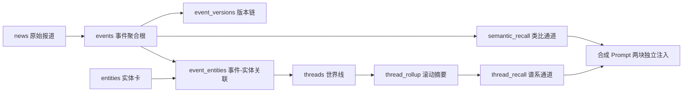

# 世界线（World Thread）设计方案

> 状态：**仅设计，未动代码**。用户已拍板：线按机制分离、自动聚类 + 人工管理入口、memory 同步后置。
> 作者：Rick / With　日期：2026-10-12

---

## 0. 一句话

把 AlphaReader 从「**事件记忆**」（这件事上次怎么说的）升级为「**世界线**」（这件事是第几章、争夺的标的是什么、钱从哪条链子传导过来）。

---

## 1. 问题诊断：现在缺的不是记忆，是世界

现状能力盘点（基于 [event_memory.py](/Users/rick/AlphaReader/backend/app/services/event_memory.py) 与 [event.py](/Users/rick/AlphaReader/backend/app/models/event.py) 实读）：

| 层次 | 实现 | 能回答 | 不能回答 |
|---|---|---|---|
| 事实原子 | `news` 表，7~30 天清理 | 今天发生了什么 | — |
| 事件聚合 | `events` + `related_to_id` 星型簇 | 同一事件的多源交叉验证 | 事件 A 和 B 是不是同一条线 |
| 版本链 | `event_versions` | 同一事件上一版说了什么 | — |
| 结果记忆 | `outcome_type` / `final_outcome` | 这类事件最后怎么收场 | — |
| 类比召回 | 语义 top-3，窗口 `0.50~0.67` | 历史上**长得像**的事件 | 同一条线的**上一章** |

### 三个硬缺口

**缺口 1：类比召回刻意把「同一条线」过滤掉了。**
`EventMemoryIndex.recall` 中 `sim >= EVENT_MEMORY_MAX_SIM(0.67)` 直接 `continue`，理由是「同一事件的不同表述，不是历史参照」。这个判断对**去重**是对的，对**串联**是致命的 —— 串联恰恰要的就是这条 0.67 以上的线。

**缺口 2：90 天窗口对长周期冲突是错的量级。**
`EVENT_MEMORY_LOOKBACK_DAYS = 90`。红海这条线按公开信息 2026-02 就已开始（马士基/赫伯罗特复航后因美以伊冲突暂停、2 月底霍尔木兹受阻），7-20 禁运、9-10 攻占穆哈全部落在窗口内外两侧。窗口一过，系统失忆。

**缺口 3：没有实体层。**
全项目只有 `news.sentiment_entity` 一个**单值**字段。没有实体表、没有实体关系、没有线。所以只能做「文本相似度」，做不了「谁在跟谁打、争夺什么标的、传导到哪」。

---

## 2. 目标与非目标

### 目标
1. 新事件到来时，能定位到它所属的**世界线**与**章节位置**；
2. 线卡给出**争夺标的 + 角色阵营 + 已验证传导链 + 未兑现观察点**；
3. 军事线与传导线**分离**存放、交叉引用；
4. 线可自动聚类生成，也可**人工钉住/合并/拆分/摘除**。

### 非目标（明确不做）
1. **不建全世界的知识图谱**。只建被 AlphaReader 信源反复触及的那部分世界。
2. **不引入图数据库**。规模估测：1.5 万事件/年 → 实体数百量级 → 线数十条。PG + 内存索引完全够。
3. **不替换现有类比召回**。谱系召回是**新增并行通道**，不动 0.67 上界逻辑。
4. **本轮不同步 agent memory**（用户决定后置，见 §9 P4）。

---

## 3. 架构：三层 + 两通道



### 三层卡片

| 卡片 | 变更速度 | 保留策略 | 单条上限 | 承载问题 |
|---|---|---|---|---|
| 事件卡 `events` | 快（小时） | 90 天 + 结局归档 | 现状 | 这一章发生了什么 |
| 实体卡 `entities` | 慢（周/月） | **永久**，增量更新 | 200 字 + 结构化属性 | 谁/什么 |
| 线卡 `threads` | 中（日） | **永久**，滚动摘要 | 500 字，4 段式 | 这条线走到哪了 |

### 两通道（关键设计判断）

**「串联世界」不靠语义，靠实体共现 + 谱系线。**

| 通道 | 找什么 | 数据源 | 注入 prompt 区块 |
|---|---|---|---|
| 类比通道（现有） | 长得像的历史事件 | 事件 embedding，top-3 | 【历史同类事件】 |
| 谱系通道（新增） | 同一条线的上一章 | 线程成员 + rollup | 【所在世界线】 |

两区块**独立注入、互不干扰**。现有 0.67 上界过滤逻辑一行不改。

---

## 4. 线的定义与分离原则

### 分离原则（用户已拍板：分离）

> **按「机制」分线，不按「地名/当事方」分线。**

判据：如果两批事件对投资者的**传导路径不同**，就必须分成两条线，即使它们共享 80% 的实体。

理由：投资人用户可交易的不是「谁打了谁」，而是「哪条价格链在动」。合并成一条线会让传导信号被军事噪声淹没。

### 案例：胡塞 / 红海拆成两条线

| 线 | 机制 | 核心实体 | 输出给用户的东西 |
|---|---|---|---|
| **T-01 也门-沙特军事对抗** | 军事控制 → 地理筹码 | 胡塞武装 / 沙特 / 也门政府军 / 联军 | 谁占了曼德海峡周边、反攻是否有效 |
| **T-02 红海航运与风险溢价传导** | 航道受阻 → 绕行 → 运费/保费/油价 | 曼德海峡 / 苏伊士 / 阿美 / 布伦特 | 通行量、保费、航程天数、油价 |

**交叉引用**：两线通过共享实体（曼德海峡、阿美）建立 `thread_link`，不合并。

### 何时进一步拆分

当一条线同时满足：① 章节数 > 30；② 存在两组几乎不共现的实体子集；③ 两组各自有独立的可交易标的 → 拆。

### 4.1 一个事件可属多条线，每条线各自标注「该事件在本线中的作用」（核心设计）

> 用户拍板：**线按机制分离，事件按作用多挂。**

同一个事件在不同机制线里扮演的角色完全不同。强制一个事件只属一条线，会让「章节」在错误的线里变成噪声 —— 分离了线却仍共享章节，等于没分离。

#### 案例：同一次胡塞袭击商船

| 世界线 | 该事件在本线中的作用 | 章节如何演进 |
|---|---|---|
| T-01 也门-沙特军事对抗 | `core`：军事行动本身 | 第 14 章，进 rollup「当前」段 |
| T-02 红海航运与风险溢价传导 | `trigger`：航运风险的触发因素 | 第 11 章，压缩为一句触发源 |

T-02 后续可独立追加承运商绕行、战争险费率、运价指数、通行量等事件 —— 这些与 T-01 的军事进展**没有章节对应关系**。两条线各自按自己的机制独立计数、独立演进。

#### 作用枚举 `thread_events.role`

固定 6 个值，禁止自由文本（自由文本会导致召回时无法归一）：

| role | 含义 | 判别问题 | 进 rollup 哪一段 |
|---|---|---|---|
| `core` | 本线的核心进展 | 去掉它这条线就断了？ | 当前 / 承 |
| `trigger` | 触发因素，非本线主体 | 它是别处发生、传导到本线的？ | 当前（标注来源） |
| `reaction` | 本线主体的应对/反制 | 是本线角色对前序的回应？ | 承 / 当前 |
| `signal` | 可量化的指标变化 | 它主要是个数字？ | 已验证传导链 |
| `context` | 背景，不推进主线 | 只提供理解背景？ | 不进 rollup，仅存档 |
| `noise` | 挂错了 | 人工判定 | 不进 rollup，等同摘除 |

**默认 `core`；不确定时取 `core` 而非 `context`。** 理由：`context` 会让章节静默消失、事后极难发现；`core` 挂错的代价只是一条噪声章节，人工可改。这是**偏向可发现性**的选择。

#### 与 `event_entities.role` 的分工（同名不同义，必须分清）

| 字段 | 层级 | 回答 | 取值 |
|---|---|---|---|
| `event_entities.role` | 实体级 | 这个**实体**在事件里是什么身份 | subject / target / stake / asset / location |
| `thread_events.role` | 线级 | 这个**事件**在这条线里是什么作用 | core / trigger / reaction / signal / context / noise |

建议 SQLAlchemy 里显式改名避免误读：`EventEntity.entity_role`、`ThreadEvent.thread_role`。

#### 带来的三个硬约束

1. **`event_id + thread_id` 唯一**：一个事件对同一条线只能有一个作用。
2. **章节计数按线独立**：`thread.chapter_count` 只统计本线 `role` 属于 `core/trigger/reaction/signal` 的条目。同一事件可同时是 T-01 第 14 章与 T-02 第 11 章。
3. **rollup 生成按线取材**：生成 T-02 摘要时只看 T-02 的章节，`trigger` 类压缩为「因 XX 袭击」一句引用，**不展开军事细节**。这是「机制分离」能否真正落地的关键 —— 否则两条线的 rollup 会趋同，分离就白做了。

### 4.2 `thread_events` 表结构（P1-a 建表）

完整 ORM / DDL 见 [p0-entity-layer-spec.md §2.4](/Users/rick/AlphaReader/docs/p0-entity-layer-spec.md)。这里只记**三个关键设计判断**。

**① 章节三字段分离：`chapter_id` / `chapter_no` / `chapter_seq`**

| 字段 | 语义 | 稳定性 | 用途 |
|---|---|---|---|
| `chapter_id` | 章节**身份** | **永久不变** | 传导链 / 观察点 / 人工操作引用 |
| `chapter_no` | 展示**序号** | 可变（重排） | **权威排序键**、前端展示、章节跳转 |
| `chapter_seq` | **写入**顺序 | 仅追加 | 回放、审计、`COUNT` 计数 |

> **字段现状（2026-10-14 实测）**：`chapter_no` / `chapter_seq` / `occurred_at` 已全部回填，
> 441/441 非空。早期文档与代码注释记的「全 NULL」已过时——
> 若再据此写「必须回退到事件时间」并让两个页面各用各的键，就会重演下文的分叉事故。

**为什么必须分离**：同一个 Event 更新到 v3，通常**仍然是原来那一章**。
事件版本是纵轴（同一事的时间演化），世界线章节是横轴（不同事的机制推进），两者正交。

若只有单一序号，回填历史事件时要么撞号、要么重排导致所有外部引用失效。
现在 `chapter_id` 承担引用、`chapter_seq` 只做审计，彻底解耦。

**★ 章节排序口径（2026-10-14 定，实现必须遵守）**

`chapter_no` 是章节的**权威展示序号**，所有对外呈现章节顺序的地方都必须以它为排序键：

```sql
ORDER BY te.chapter_no DESC NULLS LAST,
         e.last_updated_at DESC NULLS LAST,
         te.created_at DESC
```

- **方向：倒序**（最新章节在前）。与 `news_digests` / `history_digests` 口径一致，用户进线要看「现在走到哪了」，不是从第一章考古。
- **三级回退**：`chapter_no` 为 NULL 时退到事件更新时间，再退到 `created_at`。绝不能单独 `ORDER BY chapter_no`——全 NULL 时会得到数据库随机序。
- **同源要求**：`workbench.py` 的 `_chapter_rows` 与 `threads.py` 的 `list_chapters` 必须**逐字使用同一 ORDER BY**。

**⚠️ 分叉事故（务必引以为戒）**

初版工作台按 `events.last_updated_at` 排序、治理端按 `chapter_no` 排序，两者在同一条线上给出**不同章号**（实测 10+ 条线，最多 19 章错位）。

根因：`last_updated_at` 只精确到日（大量 `00:00:00`），同一天多条事件时间并列，而 `chapter_no` 当初分配时用了另一套次序。

后果：在管理台按章号摘除误挂章节，**摘到的不是工作台里看到的那一条**——真实误操作风险。

结论：排序可以回退，但**不能两个页面各回退到不同的键**。章号是跨页面的指代契约，一旦分叉，人工治理动作就会打偏。

**② 并发安全**：章节号分配用 PG advisory lock（事务级，提交自动释放），
不用 `max+1`。`uq_thread_chapter_seq` 是最后防线——即使锁失效也宁可报错，不静默错号。

**③ 快照必须存**：`events` 会被 90 天清理，线卡永久。
`snapshot_title` / `snapshot_summary` 是必需字段，不是冗余。

### 4.3 `thread_transmissions` 表结构（P1-e 建表）

> 传导链：世界线内部「A → B」的因果传导边，对应线卡 `verified_chains` 段落（§7.1）。
> **这是整套设计里最需要保守的一张表 —— 它存的是推断，不是事实。**

完整 ORM / DDL 见 [p0-entity-layer-spec.md §2.5](/Users/rick/AlphaReader/docs/p0-entity-layer-spec.md)。

#### `evidence_status` 三态：不能复用 `events.outcome_type`

| 字段 | 层级 | 语义 | 现状 |
|---|---|---|---|
| `events.outcome_type` | 事件级 | 这个**事件自身**最后怎么收场 | 已实现 |
| `events.watch_result` | 事件级 | 此前观察点是否兑现 | 已实现 |
| **`evidence_status`** | **传导边级** | A→B 这条**因果推断**的证据强度 | 本次新增 |

**关键区别**：油价事件本身可以 `confirmed`（确实涨了），
但「袭击 → 油价涨」这条边仍然只能是 `hypothesis`。**两件事，必须独立字段。**

#### 状态流转（硬约束）

```
hypothesis   → supported     ✅ 可升级（新证据出现）
supported    → contradicted  ✅ 可降级（反向证据出现）
hypothesis   → contradicted  ✅ 可降级
contradicted → supported     ❌ 禁止自动回退，必须人工仲裁
```

`contradicted` 意味着我们**曾经推错过**。若允许自动回退，系统会在证据波动时
反复横跳，形成「虚假因果确信」的动态版本。人工仲裁才能重新确立信任，并写入
`arbitrated_by` 留痕。

这与 §5.2「Embedding 0.90 不自动合并实体」是同一条保守原则：
**实体和因果边同属「错了代价极高」的东西，都该走保守策略。**

#### 引用 `chapter_id` 而非 `event_id`

传导链是长期结构，`events` 会被清理、事件会更新版本。
引用 `chapter_id` 保证章节迁移（Split/Move）与版本演进都不让传导链断头——
这是 §4.2 三字段分离设计的直接收益。

---

## 5. 自动聚类算法

### 5.1 实体抽取（P0）

**复用 `llm_news_filter` 已有评分链路**，在现有结构化 JSON 输出中**扩一个字段** `entities: string[]`（3~5 个）。

关键点：**不新增 API 调用**。这是 P0 成本几乎为零的根本原因（见 §8）。

### 5.2 实体规范化

```
entities 表：id / canonical_name / type / aliases[] / embedding / first_seen / last_seen / mention_count
```

规范化三步，零 LLM 优先：

1. **别名表精确匹配**（`胡塞武装 / 胡塞 / Houthi / 安拉拥护者` → 同一实体）
2. **规则归一化**（公司后缀、国家后缀、空格/大小写）
3. **仅当疑似新实体时**做一次 embedding 近邻比对（阈值 0.90），命中则并入，未命中则建卡

> 第 3 步是唯一有成本的地方，但只在**新实体**上触发，日常命中率极低。

### 5.3 事件归线

新事件到来，对每条活跃线计算匹配分：

```
match_score = w1 * entity_overlap   # 核心实体重合度（Jaccard，核心实体加权 3x）
            + w2 * semantic_sim     # 事件 embedding vs 线 rollup embedding
            + w3 * recency_bonus    # 线近 7 天有更新则加分
```

| 结果 | 条件 | 动作 |
|---|---|---|
| 归线 | `match_score >= T_JOIN`（默认 0.45） | 挂入，追加章节 |
| 建新线 | 无命中 且 核心实体 >= 2 且 `mention_count` 达标 | 建线，状态 `embryo` |
| 暂存 | 其余 | `unassigned`，下一轮再判 |

### 5.4 线的生命周期

| 状态 | 含义 | 触发 |
|---|---|---|
| `embryo` | 候选，章节 < 3 | 自动创建 |
| `active` | 已确认 | 章节 >= 3 或人工钉住 |
| `dormant` | 休眠 | N 天（默认 14）无新事件 |
| `resolved` | 已收束 | 人工标记或结局自动判定 |
| `merged` / `split` | 已被合并/拆分 | 人工操作，保留重定向指针 |

---

## 6. 人工管理入口

自动聚类会脏，纯人工不可扩。方案：**自动聚类 + 人工校验入口**。

### 6.1 API（建议 `backend/app/api/v1/threads.py`）

| 方法 | 路径 | 用途 |
|---|---|---|
| GET | `/api/v1/threads` | 线列表（按状态/活跃度/章节数筛选、排序） |
| GET | `/api/v1/threads/{id}` | 详情：rollup + 章节时间线 + 实体 + 关联线 |
| POST | `/api/v1/threads` | 手工建线（含初始章节绑定） |
| PATCH | `/api/v1/threads/{id}` | 改名 / 改状态 / 编辑 rollup / 编辑观察点 |
| POST | `/api/v1/threads/{id}/pin` | **钉住**：走高质量模型（v4-pro）+ 提高摘要频次 |
| POST | `/api/v1/threads/{id}/unpin` | 取消钉住 |
| POST | `/api/v1/threads/{id}/merge` | 合并到目标线（写 `merged` 重定向） |
| POST | `/api/v1/threads/{id}/split` | 按实体子集拆成两条 |
| POST | `/api/v1/threads/{id}/chapters/{eid}` | **摘除**误挂事件（DELETE） |
| POST | `/api/v1/entities/{id}/alias` | 增加/删除实体别名 |
| GET | `/api/v1/threads/stats` | 线数、章节分布、未归线事件数（**脏数据监控**） |

### 6.2 前端

最少一个「世界线」管理页，三栏：线列表 / 线详情（4 段式 rollup 可内联编辑）/ 章节流。
**优先级低于 API** —— P1 阶段可先用 API + 命令行管理。

### 6.3 人工必须做的三件事

1. **钉住核心线**（建议 20 条起步：红海-航运、红海-军事、台海、美联储、OPEC、中美关税…）；
2. **维护实体别名**（这是聚类质量的最大杠杆）；
3. **周期清理误挂**（看 `/threads/stats` 的未归线数）。

---

## 7. 线卡结构与滚动压缩

### 7.1 强制 4 段式（防 token 爆炸的核心手段）

```yaml
thread_id: T-02
name: 红海航运与风险溢价传导
status: active
started_at: 2026-02
chapter_count: 14
pinned: true

rollup:              # 硬上限 500 字，每次更新整体重写
  起: 2026-02 马士基/赫伯罗特复航后因美以伊冲突暂停；2月底伊朗战事致霍尔木兹受阻
  承: 07-20 胡塞对沙特"封锁对封锁"海上禁运 → 09-10 攻占穆哈+祖巴卜+丕林岛+哈尼什群岛
  转: 10-04 政府军"也门黎明"反攻；10-05 联军100架战机/324目标；胡塞三轮打击利雅得+拉比格
  当前: 10-09 利雅得机场弹道导弹3死；10-11 沙-巴-土启动集体防御；10-12 本次打击

entities:            # 角色标注（谁在打、谁被打、标的、受袭资产）
  - {name: 曼德海峡, role: 争夺标的, note: 全球约12%商品贸易}
  - {name: 胡塞武装, role: 攻击方, note: 成本不对称优势}
  - {name: 阿美,     role: 受袭资产, note: 拉比格/延布/利雅得/胡赖斯}

verified_chains:     # 已验证传导链（只放有数据支撑的）
  - 海峡受阻 → 绕行好望角 → 延布至韩国航程 24→54 天
  - 通行量 -56%（禁运首周）→ 战争险 25万→1000万美元/航次 → 布油破 100 美元
  - 累计击袭沙特油轮 8 艘 / 迫使 29 艘改道

open_watches:        # 未兑现观察点（供下一章对照）
  - 曼德海峡日通行量是否回到 10 艘以上（反攻是否有效）
  - 阿美设施受损的独立核实（双方口径长期分歧）
  - 沙-巴-土集体防御是否实质落地
```

### 7.2 滚动压缩规则（硬性）

1. **每次更新只喂「当前 rollup + 新章节」，永不喂全量历史。** 这是 token 不爆炸的唯一保证。
2. 旧章节压成一行：`MM-DD｜一句话｜状态`。
3. `verified_chains` 每条必须有**数字或可核实事实**，无数据的传导猜测一律不写。
4. `open_watches` 上限 5 条，兑现的移入 `verified_chains`，过期的删除。
5. rollup 超 500 字时强制重写压缩，不许追加。

---

## 8. Token 成本测算（回答问题 4）

### 8.1 计费前提

| 项 | 值 | 来源 |
|---|---|---|
| 模型 | `deepseek-flash`（`config.py: LLM_MODEL`） | 项目配置 |
| 输入价 | $0.14 / 1M（cache miss）；$0.0028 / 1M（**cache hit**） | [DeepSeek 官方定价](https://api-docs.deepseek.com/zh-cn/quick_start/pricing) |
| 输出价 | $0.28 / 1M | 同上 |
| 上下文 | 1M | 同上 |
| 实测基线 | 42 events / 24h | 健康巡检验证的正常基线 |
| 评分批量 | `LLM_BATCH_SIZE = 30`，`LLM_MAX_CONCURRENCY = 3` | `config.py` |

> 注：若 `deepseek-flash` 实际解析为 V4.1 Flash（2026-09-10 起），峰值价 $0.30/$1.20，约为上表的 **2.1 倍**。下文按官方 v4-flash 价给下界，实际取 2 倍即上界。

### 8.2 现状成本（量级估算，非账单）

假设每日约 400 条进入 LLM 评分（含英文两阶段）、42 次事件合成：

| 环节 | 输入/日 | 输出/日 | 日成本 |
|---|---|---|---|
| 中文评分 | ~180K | ~60K | $0.042 |
| 英文两阶段（评分+翻译） | ~72K | ~24K | $0.017 |
| 事件合成（含记忆注入） | ~63K | ~21K | $0.015 |
| **合计** | — | — | **≈ $0.074 / 日 ≈ $2.2 / 月** |

叠加重试、内容安全二分、翻译批次放大，实际**约 $3~8 / 月**量级。

### 8.3 增量成本（这才是问题 4 的答案）

| 分期 | 增量动作 | 增量 token/日 | 月增量 |
|---|---|---|---|
| **P0** 实体抽取 | 同一次评分调用**扩字段**，零新增调用；输出 +40 tok/条 × 400 | 输出 16K | **$0.13** |
| **P1** 自动聚类 | 纯 SQL + 内存计算，**零 LLM** | 0 | **$0** |
| **P2** 线卡摘要 | 20 条钉住线 × 1 次/日；输入 ~1K + 输出 ~500 tok | 输入 20K / 输出 10K | **$0.17** |
| **P2** 线注入合成 | 42 事件 × +400 tok 输入 | 输入 17K | **$0.07**（cache 命中后趋近 $0） |
| **P3** 线级结局 | 少量 | 忽略 | **~$0.05** |
| **合计** | — | — | **≈ $0.4 / 月** |

**保守翻倍（含重试、thinking 输出、V4.1 Flash 峰值价）：$1~2 / 月。**

### 8.4 结论

> **Token 耗费不多，增量在个位数人民币量级。**

三个支撑理由：

1. **P0 是「扩字段」不是「加调用」** —— 实体抽取搭现有评分链路的便车，边际成本只是几十个输出 token。
2. **P1 完全不用 LLM** —— 聚类是集合运算。
3. **DeepSeek 单价极低** —— 输入 $0.14/1M。整条世界线的日增量约 47K token，折合不到 5 分钱人民币。

### 8.5 真正的风险不是钱，是这两个

**风险 A：thinking 模式输出放大。**
v4-flash 默认开启思考模式，推理 trace 计入输出 token，可放大 5~10 倍。
**对策**：rollup 压缩、实体抽取这类机械任务**显式关闭 thinking**（非思考模式）。

**风险 B：线卡不压缩导致输入膨胀 + 质量劣化。**
若不做 §7.2 的滚动压缩：

| 章节数 | 单次输入 | 20 线日输入 | 月成本 | 且 |
|---|---|---|---|---|
| 20 章 | 6K tok | 120K | $0.5 | 可接受 |
| 100 章 | 30K tok | 600K | $2.5 | 开始变慢 |
| 365 章（1 年） | 110K tok | 2.2M | $9.2 | **摘要质量明显劣化** |

即便最坏情况也仍在 $10/月内 —— **钱不是问题，「越长越糊」才是**。所以滚动压缩是**质量红线**，不是成本红线。

### 8.6 成本优化三招（可选）

1. **稳定前缀前置**：system prompt 与线卡放 prompt 最前，命中 DeepSeek context cache（输入降 50 倍，$0.0028/1M）。
2. **差异化模型**：钉住的 20 条线用 v4-pro 做高质量 rollup（$0.435/$0.87），其余用 flash。
3. **摘要频次分级**：钉住线每日更新，`active` 线 3 日一次，`dormant` 线不更新。

---

## 9. 分期落地

| 期 | 内容 | 依赖 | 增量成本 | 交付物 |
|---|---|---|---|---|
| **P0** | `entities` + `event_entities` 表；评分 JSON 扩 `entities[]`；别名规范化 | 无 | ~$0.13/月 | 实体层可用 |
| **P1** | `threads` 表 + 实体共现聚类 + 生命周期状态机 | P0 | $0 | 线自动生成 |
| **P1.5** | 人工管理 API（§6.1）+ 最简页面 | P1 | $0 | 可人工校正 |
| **P2** | `thread_rollup` 4 段式滚动摘要 + `thread_recall` 通道，与类比召回并行注入 | P1 | ~$0.24/月 | 谱系召回生效 |
| **P3** | 线级结局记忆（`thread.outcome`），替代事件级 90 天窗口的部分职能 | P2 | ~$0.05/月 | 长周期规律 |
| **P4** | （后置）世界线回灌到 agent 长期记忆 | P2 | — | **本轮不做** |

**P4 说明**：用户决定后置。待 P2 稳定后再设计回灌 schema —— 建议复用同一 4 段式结构，避免两套格式。

---

## 10. 风险与边界

| 风险 | 影响 | 对策 |
|---|---|---|
| 实体别名不全会拆出重复线 | 线碎裂 | 别名表 + 高频实体人工审一次 + `/threads/stats` 监控 |
| 泛化实体（如「美国」）把无关事件串一起 | 线污染 | 核心实体按 `mention_count` 加权；停用词式通用实体不参与 Jaccard 主判定 |
| LLM 编造传导链 | 事实污染 | `verified_chains` 强制要求数字/可核实事实，与现有 `EVENT_MEMORY_MIN_PATTERN_COUNT` 护栏同思路 |
| rollup 越长越糊 | 质量劣化 | 500 字硬上限 + 每次重写 + 旧章节压一行 |
| 误挂事件 | 用户信任受损 | 提供摘除 API，摘除后不自动重挂（写 `detached_events` 黑名单） |
| 90 天窗口与永久线冲突 | 线断头 | 线卡永久保留，只事件卡过期；线引用事件时用快照文本而非外键 |

> 最后一条是关键：`threads` 不能直接外键依赖会被清理的 `news`，必须存**章节快照文本**（标题 + 一句话 + 时间 + 事件 ID 软引用）。

---

## 11. 案例对照：10-12 胡塞打击

**数据边界声明**：公开检索仅追到 **10-11**（利雅得机场导弹、3 死、沙-巴-土启动集体防御）。10-12 当天的具体打击**未取得可独立核实的信源**。以下对照不受该缺口影响。

### 现在会输出的（类比通道）

```
【历史同类事件（仅作背景参照）】
（已召回 3 个，其中 2 个结局「已确认/落地」方向一致，可据此归纳…）
1. [09-19｜developing｜v2] 胡塞袭击延布阿美设施　…
   结局: 已确认/落地 | 结束于 2026-09-25 | 持续约 144h
2. [10-03｜new｜v1] 胡塞袭击利雅得阿美设施　…
   结局: 延期
3. [07-20｜stable｜v3] 胡塞宣布对沙特海上禁运　…
   结局: 已确认/落地
```

**问题**：把 10-12 当成「又一次同类袭击」，给的是**统计规律**。

### 应该输出的（新增谱系通道）

```
【所在世界线】
■ T-01 也门-沙特军事对抗（active，第 14 章，起于 2026-02，钉住）
  起: 2026-02 复航暂停；2月底霍尔木兹受阻
  承: 07-20 海上禁运 → 09-10 攻占穆哈+丕林岛+哈尼什群岛
  转: 10-04 政府军"也门黎明"反攻；10-05 联军100架战机/324目标
  当前: 10-09 利雅得机场3死；10-11 沙-巴-土集体防御；10-12 本次打击
  争夺标的: 曼德海峡周边控制权（祖巴卜/丕林岛/哈尼什群岛）
  未兑现观察点: 政府军反攻是否收复穆哈（双方口径分歧）

■ T-02 红海航运与风险溢价传导（active，第 11 章，钉住）— 与 T-01 共享实体
  已验证传导链:
    · 海峡日通行 30→6 艘（09-10）｜禁运首周通行量 -56%
    · 延布→韩国航程 24→54 天
    · 战争险 25万→1000万美元/航次
    · 布油破 100 美元
  未兑现观察点: 通行量是否回到 10 艘以上；阿美受损独立核实
```

**差别**：类比通道说「这类事通常怎么收场」；谱系通道说「你现在站第几章、争夺什么、钱从哪条链子过来」。后者才是投资人要的。

### 同一事件的两条线记录（§4.1 实例化）

同一个事件（胡塞袭击商船）在 `thread_events` 里存两条记录：

| thread_id | role | 本线章节号 | 进 rollup 的形态 |
|---|---|---|---|
| T-01 | `core` | 14 | 「10-12 胡塞袭击商船」完整展开 |
| T-02 | `trigger` | 11 | 「因 10-12 袭击」一句引用，不写军事细节 |

T-02 的第 12、13 章由绕行/费率/运价等**独立事件**推进，与 T-01 的章节号无对应关系。这正是「世界线章节能够围绕自己的机制独立演进」的落点。

---

## 12. 待拍板 / 下一步

| # | 问题 | 建议 |
|---|---|---|
| 1 | 钉住线首批清单（建议 20 条）由谁定？ | Rick 给清单，我按 §4 机制原则校验是否该拆分 |
| 2 | 线卡摘要用 flash 还是 pro（钉住线）？ | 钉住线 pro，其余 flash（§8.6） |
| 3 | 前端管理页是否在 P1.5 内做？ | 建议先 API，页面后置 |
| 4 | 谱系召回每条事件注入几条线？ | 建议 top-1 主线 + 至多 1 条关联线，控 token |
| 5 | 本设计是否先合入 `docs/` 供批注？ | 建议批注后再定 P0 范围 |

---

## 附：关键文件索引

| 文件 | 作用 |
|---|---|
| [event_memory.py](/Users/rick/AlphaReader/backend/app/services/event_memory.py) | 现有类比通道，谱系通道需与之并行 |
| [event.py](/Users/rick/AlphaReader/backend/app/models/event.py) | 事件聚合根模型，实体/线表参照此风格 |
| [event_synthesizer.py](/Users/rick/AlphaReader/backend/app/services/event_synthesizer.py) | 合成入口，`_recall_memory` 为注入点 |
| [llm_news_filter.py](/Users/rick/AlphaReader/backend/app/services/llm_news_filter.py) | P0 实体抽取的挂载点（搭评分调用便车） |
| [config.py](/Users/rick/AlphaReader/backend/app/config.py) | `EVENT_MEMORY_*` / `ENTITY_EXTRACTION_*` / `EVENT_SYNTH_MAX_TOKENS` |
| [p0-entity-layer-spec.md](/Users/rick/AlphaReader/docs/p0-entity-layer-spec.md) | **P0 实施规格**：§2.4 `thread_events` / §2.5 `thread_transmissions` 完整 ORM + DDL |
| [world-thread-routing-assessment.md](/Users/rick/AlphaReader/docs/world-thread-routing-assessment.md) | 归线算法评估：字段命名隔离、Jaccard 分母、`is_generic` 排除 |
| [world-thread-governance-assessment.md](/Users/rick/AlphaReader/docs/world-thread-governance-assessment.md) | 人工治理评估：排除持久化（命门）、三套认证选型、restore 补强 |

## 附：信源

- [DeepSeek 模型 & 价格（官方）](https://api-docs.deepseek.com/zh-cn/quick_start/pricing)
- [红海局势升温，胡塞武装发动大规模导弹无人机袭击（中财网，2026-10-06）](https://www.cfi.net.cn/p20261006000057.html)
- [10月11日：中国不急着站队也门（搜狐军事，2026-10-11）](https://mil.sohu.com/a/1086138294_121612983)
- [红海航道（百度百科，2026-10-09 更新）](https://baike.baidu.com/item/%E7%BA%A2%E6%B5%B7%E8%88%AA%E9%81%93/68931322)
- [沙特聯軍反攻胡塞 也門軍稱奪回曼德海峽（新唐人，2026-10-06）](https://d3b4tr6pftdrkw.cloudfront.net/gb/2026/10/06/a104139380.html/amp)
